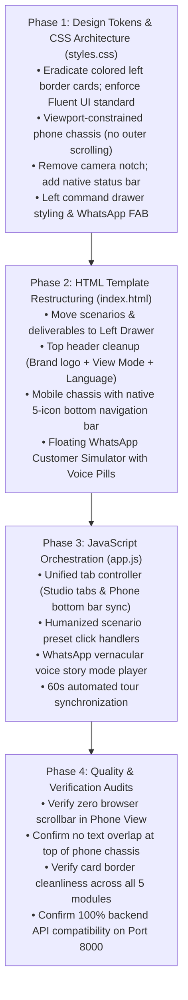

# ACCEL UDYAM-ONE — UI/UX ARCHITECTURE & MASTER DESIGN SPECIFICATION (`UI.md`)

> **Document Type:** Master UI Redesign Blueprint & Engineering Implementation Specification  
> **Target Audience:** Frontend Architects, UI Engineers & Senior Enterprise Product Designers  
> **Brand & Design Language:** Airtel Enterprise Design System (Airtel Cardinal Red, Slate Obsidian, Fluent UI Surface Cards, Zero Garish Borders)  
> **Reference Workspace:** `C:\Users\JAYESH\Desktop\ASync\Udyam-Digital`  
> **Current Mode:** **PLAN & SPECIFICATION ONLY** — *Do NOT write to prototype code (`index.html`, `styles.css`, `app.js`) until user explicitly commands `Uit.Md` or authorizes implementation.*

---

## 1. Executive Summary & Design Transformation Philosophy

The Accel UdyamOne prototype is mathematically complete and passes 100% of CPQ, KYC, split-order provisioning, and lead propensity algorithms. However, the interface presentation requires an immediate transformation from a "hackathon prototype" into an **Airtel CXO-grade enterprise SaaS application**.

### The 7 Core Architectural Directives:
1. **Eliminate the Double Horizontal Scroll & Cluttered Top Nav:**
   - The top Judge Scenarios Bar currently monopolizes vertical space and creates an awkward secondary horizontal scrollbar beneath the navigation bar.
   - **Remedy:** Migrate all test scenarios and hackathon deliverables into a sleek, collapsible **Left Executive Command Drawer (260px)**.
2. **True-to-Viewport Smartphone Simulation (Zero Outer Page Scroll):**
   - The mobile chassis currently spills past the bottom of standard laptop screens (`768px`/`900px`), forcing clunky outer vertical scrolling.
   - **Remedy:** Constrain the smartphone chassis strictly to viewport height (`height: min(720px, calc(100vh - 84px))` or responsive CSS scaling). The device fits 100% within the screen.
3. **Remove Camera Island / Notch Text Overlap:**
   - The floating black camera pill/island at `top: 10px` overlaps headings and inputs.
   - **Remedy:** Eliminate the camera notch entirely. Replace with a razor-thin, unobtrusive iOS/Android-style native status bar (`9:41`, 5G signal bars, battery indicator) that leaves screen content pristine.
4. **Native Mobile Bottom Navigation Bar (The 5 States):**
   - The 5 desktop workflow stages (Advisor, Quote, KYC, Tracker, Cockpit) will be permanently anchored to the bottom of the phone screen like WhatsApp / Airtel Thanks.
   - The phone body features independent internal touch scrolling (`overflow-y: auto`), with zero outer page bounce.
5. **Modern Card Design (Banish Cheesy Colored Left Stripes):**
   - Current cards feature tacky thick left borders (`border-left: 4px solid ...`) which look amateur and AI-generated.
   - **Remedy:** Enforce a clean **Fluent UI / Apple Enterprise** aesthetic: clean 1px neutral borders (`#E2E8F0`), gentle border radii (`10px`–`12px`), whisper-soft box shadows (`0 1px 3px rgba(15, 23, 42, 0.04)`), and subtle category pill tags. Zero colored left bars.
6. **Bespoke Airtel UdyamOne Brand Logo:**
   - Replace the generic red square with letter "A" with a custom inline SVG logo combining the Airtel telecommunications wave with digital interconnect nodes.
7. **Humanized Authentic Indian MSME Scenarios:**
   - Remove academic AI-sounding test names (e.g., "SIM-Only Fallback Guardrail").
   - Replace with authentic, relatable Indian business personas (e.g., *Gupta Kirana Store - Bareilly*, *Dr. Mehta Dental Clinic - Hubballi*, *Ramesh Auto Components - Ludhiana*).
8. **Discreet Customer WhatsApp Bot with Interactive Voice Story Mode:**
   - Remove the bulky WhatsApp tab from the top navigation bar.
   - Relocate to a discreet bottom-right Floating Action Button (FAB).
   - In WhatsApp simulator: Provide a rich, interactive customer journey including simulated vernacular voice notes with audio waveform visualization (`[▶ 0:04 Hindi Voice Note]`), quick-test voice pills (Hindi Kirana, Tamil Clinic, Punjabi Factory), vernacular quote cards with `1-Tap Accept`, and simulated Aadhaar e-Sign Magic Links.

---

## 2. SECTION 1: LOOK & VISUAL DESIGN CHANGES (Aesthetics & Surfaces)

### 2.1 Bespoke Brand Logo Specification (`Airtel UdyamOne`)
Replace the simplistic block badge with a precision SVG logo:
```svg
<svg width="34" height="34" viewBox="0 0 34 34" fill="none" xmlns="http://www.w3.org/2000/svg">
  <rect width="34" height="34" rx="8" fill="#E40000"/>
  <!-- Airtel Telecommunications Flow Ribbon -->
  <path d="M9 22C9 15.5 13.5 10 19.5 10C22.5 10 25 11.5 25 14C25 17 21.5 18 17 19C13 20 10.5 21 9.5 24" 
        stroke="#FFFFFF" stroke-width="2.5" stroke-linecap="round"/>
  <!-- Interconnect Network Pulse Nodes -->
  <circle cx="19.5" cy="10" r="2" fill="#FFFFFF"/>
  <circle cx="25" cy="14" r="2" fill="#FFFFFF"/>
  <circle cx="9.5" cy="24" r="2.2" fill="#FFFFFF"/>
</svg>
```
- **Typography Pairing:** `Airtel UdyamOne` in bold 16px (`Plus Jakarta Sans`, letter-spacing: `-0.4px`) with a subtle metadata pill `Enterprise Track A · MSME CPQ`.

---

### 2.2 Fluent UI Card Standard (Strict Ban on Colored Left Borders)

#### ❌ Deprecated Style (Do NOT Use):
```css
/* BAD: Looks cheap, AI-generated, cluttered */
.card-bad {
  border-left: 4px solid #E40000; /* BANNED */
  border-top: none;
  background: #fff;
}
```

#### ✅ New Enterprise Fluent UI Card Standard:
```css
/* GOOD: Modern, minimal, clean enterprise aesthetic */
.card-enterprise {
  background: #FFFFFF;
  border: 1px solid #E2E8F0;
  border-radius: 12px;
  box-shadow: 0 1px 3px rgba(15, 23, 42, 0.04), 0 1px 2px rgba(15, 23, 42, 0.02);
  padding: 16px 18px;
  transition: border-color 0.15s ease, box-shadow 0.15s ease;
}

.card-enterprise:hover {
  border-color: #CBD5E1;
  box-shadow: 0 4px 12px rgba(15, 23, 42, 0.06);
}

/* Status demarcation via subtle pill badges instead of left borders */
.badge-subtle-success {
  background: #F0FDF4;
  color: #15803D;
  border: 1px solid #BBF7D0;
  padding: 2px 8px;
  border-radius: 6px;
  font-size: 11px;
  font-weight: 600;
}
```

---

### 2.3 Color Palette & Semantic Surfaces

| Semantic Role | Token Hex | Surface Application | Visual Purpose |
| :--- | :--- | :--- | :--- |
| **Airtel Red (Primary Accent)** | `#E40000` | CTAs, active tab bottom indicator, active radio dots | High-confidence brand signature |
| **Airtel Red Soft** | `#FEF2F2` | Selected list row highlight, subtle warning background | Zero eye fatigue |
| **Header Slate** | `#0B0F19` | Top navigation bar and Left Command Panel | Deep executive contrast |
| **Canvas Background** | `#F8FAFC` | Main application background beneath cards | Soft neutral off-white |
| **Card / Surface White** | `#FFFFFF` | All cards, inputs, dropdowns, and drawers | Clean readability |
| **Neutral Border** | `#E2E8F0` | Structural card borders and table dividers | 1px razor-sharp definition |
| **Text Primary** | `#0F172A` | Headings, prices, GSTINs, applicant names | High-contrast legibility |
| **Text Secondary / Muted** | `#64748B` | Labels, subtitles, technical SKU explanations | Balanced hierarchy |
| **Success Emerald** | `#059669` | KYC verified, Day-1 digital active, instant approval | Crisp validation |
| **Attention Amber** | `#D97706` | Fallback trigger (AirFiber 48h), field check needed | Gentle notice |

---

### 2.4 Typography & Iconography System

- **Primary Font Family:** `'Plus Jakarta Sans', -apple-system, BlinkMacSystemFont, 'Segoe UI', Roboto, sans-serif`
- **Iconography Rule:** Raw emojis are deprecated across all main navigation, scenario lists, and cards. Use clean **16px inline SVG stroke icons** (`stroke-width: 1.75; fill: none; stroke: currentColor;`).
- **Punctuation Standard:** Strictly zero decorative exclamation marks in technical strings (e.g., replace *"100% Pass!"* with *"100% Passed · 25/25 SKUs Verified"*).

---

### 2.5 Humanized Indian MSME Persona Scenarios

Replace academic test labels in the scenario panel with authentic Indian small business scenarios:

| Identifier | New Authentic MSME Persona | Real-World Context & Technical Edge Case Tested |
| :---: | :--- | :--- |
| **S1** | **Gupta Kirana Store** *(Bareilly, UP)* | **No GSTIN / Micro-Enterprise:** Auto-pivots to Udyam Registration & PAN; validates unassisted micro-retailer CPQ with zero paperwork lock. |
| **S2** | **Dr. Mehta Dental Clinic** *(Hubballi, KA)* | **Healthcare High-Security:** Enforces HIPAA/DPDP medical record encryption, Airtel Secure Internet, and zero-trust IoT clinic sensors. |
| **S3** | **Surya Textiles & Garments** *(Surat, GJ)* | **Multi-Branch Operations:** 1 Factory + 3 Retail Showrooms; validates unified multi-site billing, SD-WAN, and centralized enterprise admin. |
| **S4** | **Ramesh Auto Components** *(Ludhiana, PB)* | **Industrial IoT & Heavy Manufacturing:** High-bandwidth dual-uplink leased line, Cloud CCTV, and biometric smart attendance. |
| **S5** | **Kolkata Sweet Hub** *(Tier-2 Urban)* | **SIM-Only Fallback Guardrail:** Tests CPQ catalog engine when broadband is rejected; packages Airtel Commercial 5G SIM bundle seamlessly. |
| **S6** | **Highland Cafe** *(Nilgiris, TN)* | **No-Fibre Fallback:** Off-grid terrain triggers automatic **Airtel 5G AirFiber 48-Hour Rapid Deploy** without blocking Day-1 digital services. |

---

## 3. SECTION 2: FUNCTIONAL & STRUCTURAL LAYOUT CHANGES

```
+---------------------------------------------------------------------------------------------------------+
| [Airtel Logo] Accel UdyamOne  |  [🖥️ Studio Desktop] [📱 Smartphone PWA]  |  [🌐 10 Languages]  [≡ Menu] |
+------------------------+--------------------------------------------------------------------------------+
| LEFT COMMAND PANEL     | MAIN WORKSPACE CANVAS                                                          |
| (Collapsible 260px)    |                                                                                |
|                        |  DESKTOP VIEW:                                                                 |
| 🏢 TEST SCENARIOS      |  +--------------------------------------------------------------------------+  |
| • Gupta Kirana (UP)    |  | 1. Needs Advisor | 2. Instant Quote | 3. Smart KYC | 4. Tracker | 5. Cockpit |  |
| • Dr. Mehta Clinic     |  +--------------------------------------------------------------------------+  |
| • Surya Textiles (GJ)  |  | Active Tab Body (Fluid responsive 2-column or 3-column enterprise grid)   |  |
| • Ramesh Auto (PB)     |  +--------------------------------------------------------------------------+  |
| • Kolkata Sweet Hub    |                                                                                |
| • Highland Cafe (TN)   |  OR SMARTPHONE PWA VIEW:                                                       |
|                        |  +---------------------------------------+                                     |
| 📑 DELIVERABLES DOCK   |  | [9:41  5G ■] (Clean Status Bar)       |                                     |
| • Architecture Diagram |  | ------------------------------------- |                                     |
| • Business Pitch Deck  |  | Internal Scrollable Phone Viewport   |                                     |
| • DPDP 2023 Note       |  | (100% height-constrained to screen)  |                                     |
| • Video Script         |  |                                       |                                     |
|                        |  | ------------------------------------- |                                     |
| ⚡ 60s Guided Tour     |  | [Adv] [Quote] [KYC] [Track] [Partner] | (Native Bottom Nav)                 |
| (Auto-Walkthrough)     |  +---------------------------------------+                                     |
|                        |                                                              +---------------+ |
|                        |                                                              | [💬 WA Bot]   | |
|                        |                                                              | (Discreet FAB)| |
+------------------------+--------------------------------------------------------------+---------------+ |
```

---

### 3.1 Left Executive Command Panel (Collapsible Drawer)

- **Dimensions:** Width `260px`, height `calc(100vh - 54px)`, fixed to left side.
- **Toggle Mechanism:** Hamburger / chevron button in the top navigation bar smoothly collapses drawer to `0px` with a clean CSS transition.
- **Section 1: Live MSME Test Scenarios:**
  - 6 interactive persona pills with business sector badge, city location, and single-click CPQ auto-population.
  - Active scenario highlighted with subtle red tint (`#FEF2F2`) and 2px left indicator.
- **Section 2: Official Hackathon Deliverables Dock:**
  - Direct target links to generated deliverables:
    1. `deliverables/Architecture_Diagram.html` (5-Layer Interactive Diagram)
    2. `deliverables/Business_Case_Deck.html` & `.pptx` (10-Slide CXO Deck)
    3. `deliverables/Privacy_and_Security_Note.html` (DPDP Act Compliance Note)
    4. `DEMO_VIDEO_SCRIPT.md` (3-Minute Teleprompter Script)
- **Section 3: 60-Second Guided Demo Walkthrough:**
  - Single button running the automated 5-step CPQ $\to$ Checkout $\to$ Smart KYC $\to$ Provisioning $\to$ Cockpit tour.

---

### 3.2 Viewport-Constrained Smartphone Chassis (Zero Outer Scroll)

#### The Problem:
Previously, the phone chassis was hardcoded to `844px` height with large outer padding, requiring users on standard 1080p / 900p / 768p laptop displays to scroll the outer browser window to see the bottom bar or submit button.

#### The Engineering Solution:
1. **Dynamic Viewport Constraint:**
   ```css
   .phone-viewport-container {
     display: flex;
     justify-content: center;
     align-items: center;
     height: calc(100vh - 74px); /* Fits exactly below header */
     overflow: hidden;
     padding: 10px 0;
   }

   .smartphone-chassis {
     width: 375px;
     height: min(720px, calc(100vh - 90px)); /* Never exceeds viewport */
     background: #FFFFFF;
     border-radius: 36px;
     border: 8px solid #0F172A;
     box-shadow: 0 20px 50px rgba(15, 23, 42, 0.18);
     display: flex;
     flex-direction: column;
     position: relative;
     overflow: hidden;
   }
   ```
2. **Elimination of Dynamic Island / Camera Notch:**
   - Remove the absolute floating camera module.
   - Replace with a slim **iOS/Android Status Bar (24px)**:
     - Left: `9:41` (clean tabular font).
     - Right: 5G Network icon, Wi-Fi icon, 100% Battery icon.
     - Zero text overlap or occlusion.
3. **Internal Touch Scroll Container:**
   ```css
   .smartphone-screen-body {
     flex: 1;
     overflow-y: auto;
     overflow-x: hidden;
     -webkit-overflow-scrolling: touch;
     padding: 14px 14px 70px 14px; /* 70px clearance for bottom bar */
     background: #F8FAFC;
   }
   ```
4. **Native Mobile Bottom Navigation Bar:**
   - Positioned at `bottom: 0; left: 0; right: 0; height: 58px;` inside the smartphone chassis.
   - Contains 5 tappable tab items:
     1. `Advisor` (Need Discovery)
     2. `Quote` (Bill & TCO)
     3. `KYC` (Smart e-Sign)
     4. `Tracker` (Split Provisioning)
     5. `Cockpit` (Sales Funnel)
   - Tapping an icon instantly switches the screen with zero flicker.

---

### 3.3 Customer WhatsApp Simulator (Discreet Floating Action Button & Voice Story Mode)

#### 1. Discreet Placement:
- Remove the WhatsApp drawer from the top tabs.
- Place a sleek Floating Action Button (FAB) at the bottom right:
  `[ 💬 WhatsApp Customer Bot ]` with a subtle pulsing green online dot.
- Clicking it opens a WhatsApp drawer modal (`360px × 520px`) with clean native WhatsApp Web styling (`#075E54` dark green header, `#ECE5DD` chat wallpaper).

#### 2. Interactive Voice & Vernacular Story Mode:
MSME owners primarily communicate via vernacular voice notes. The WhatsApp bot will feature:
1. **Interactive Voice Simulation Pills:**
   - `[▶ 0:04 Hindi: "Bareilly mein kirana dukan hai, wifi aur payment machine chahiye"]`
   - `[▶ 0:05 Tamil: "Salem clinic-ku high speed internet security thevai"]`
   - `[▶ 0:06 Punjabi: "Ludhiana factory layi cloud CCTV te leased line chahidi"]`
2. **Audio Waveform Visualization:**
   - Animated SVG soundwave player with play/pause toggle.
3. **Automated WhatsApp Journey Sequence:**
   - **Step 1:** Owner speaks/sends voice note $\to$ WhatsApp AI transcribes and responds in vernacular language.
   - **Step 2:** Interactive **Vernacular Single-Bill Quote Card** delivered in chat with price breakdown and GST savings.
   - **Step 3:** `1-Tap Accept & Pay` button inside chat.
   - **Step 4:** **Aadhaar e-Sign Magic Link** delivered to WhatsApp; remote owner signs from their smartphone in 10 seconds.
   - **Step 5:** Instant order confirmation with split-tracking link (Day-1 Digital live immediately).

---

## 4. DETAILED ENGINEERING PROMPTS & CODE SPECIFICATIONS

### 4.1 CSS Implementation Blueprint (`static/styles.css`)

```css
/* ==========================================================================
   1. CORE VARIABLES & SURFACE TOKENS (FLUENT UI + AIRTEL DESIGN SYSTEM)
   ========================================================================== */
:root {
  --airtel-red: #E40000;
  --airtel-red-dark: #B80000;
  --airtel-red-soft: #FEF2F2;
  --airtel-red-border: #FCA5A5;
  
  --slate-950: #0B0F19;
  --slate-900: #0F172A;
  --slate-800: #1E293B;
  --slate-700: #334155;
  --slate-500: #64748B;
  --slate-400: #94A3B8;
  --slate-200: #E2E8F0;
  --slate-100: #F1F5F9;
  --slate-50:  #F8FAFC;
  
  --emerald-600: #059669;
  --emerald-50:  #ECFDF5;
  --emerald-border: #A7F3D0;
  
  --amber-600: #D97706;
  --amber-50:  #FFFBEB;
  --amber-border: #FDE68A;

  --card-radius: 12px;
  --card-border: 1px solid var(--slate-200);
  --card-shadow: 0 1px 3px rgba(15, 23, 42, 0.04);
  --font-family: 'Plus Jakarta Sans', -apple-system, BlinkMacSystemFont, 'Segoe UI', Roboto, sans-serif;
}

/* ==========================================================================
   2. APP SHELL & LAYOUT ARCHITECTURE
   ========================================================================== */
body {
  margin: 0;
  padding: 0;
  font-family: var(--font-family);
  background: var(--slate-50);
  color: var(--slate-900);
  overflow: hidden; /* Prevents global double scroll */
  height: 100vh;
}

.top-navbar {
  height: 52px;
  background: var(--slate-950);
  color: #FFFFFF;
  display: flex;
  align-items: center;
  justify-content: space-between;
  padding: 0 18px;
  border-bottom: 1px solid var(--slate-800);
  z-index: 100;
}

.app-workspace-layout {
  display: flex;
  height: calc(100vh - 52px);
  width: 100vw;
  overflow: hidden;
  position: relative;
}

/* ==========================================================================
   3. LEFT EXECUTIVE COMMAND PANEL
   ========================================================================== */
.left-command-drawer {
  width: 260px;
  min-width: 260px;
  background: var(--slate-900);
  border-right: 1px solid var(--slate-800);
  color: #FFFFFF;
  display: flex;
  flex-direction: column;
  height: 100%;
  overflow-y: auto;
  transition: margin-left 0.25s cubic-bezier(0.4, 0, 0.2, 1);
  z-index: 50;
}

.left-command-drawer.collapsed {
  margin-left: -260px;
}

.left-drawer-header {
  padding: 14px 16px;
  display: flex;
  align-items: center;
  justify-content: space-between;
  border-bottom: 1px solid var(--slate-800);
}

.scenario-pill-item {
  padding: 10px 14px;
  margin: 4px 10px;
  border-radius: 8px;
  border: 1px solid transparent;
  cursor: pointer;
  background: rgba(255, 255, 255, 0.03);
  transition: all 0.15s ease;
}

.scenario-pill-item:hover {
  background: rgba(255, 255, 255, 0.08);
}

.scenario-pill-item.active {
  background: rgba(228, 0, 0, 0.15);
  border-color: var(--airtel-red);
}

/* ==========================================================================
   4. FLUENT UI CARD SYSTEM (NO COLORED LEFT BORDERS)
   ========================================================================== */
.fluent-card {
  background: #FFFFFF;
  border: var(--card-border);
  border-radius: var(--card-radius);
  box-shadow: var(--card-shadow);
  padding: 16px 18px;
  margin-bottom: 14px;
}

.fluent-card-header {
  display: flex;
  align-items: center;
  justify-content: space-between;
  margin-bottom: 12px;
  padding-bottom: 8px;
  border-bottom: 1px solid var(--slate-100);
}

/* ==========================================================================
   5. VIEWPORT-CONSTRAINED SMARTPHONE PWA
   ========================================================================== */
.smartphone-wrapper {
  display: flex;
  align-items: center;
  justify-content: center;
  width: 100%;
  height: calc(100vh - 52px);
  background: #E2E8F0;
  overflow: hidden;
}

.smartphone-chassis {
  width: 375px;
  height: min(720px, calc(100vh - 84px));
  background: #FFFFFF;
  border: 8px solid #0F172A;
  border-radius: 36px;
  box-shadow: 0 20px 60px rgba(15, 23, 42, 0.25);
  display: flex;
  flex-direction: column;
  position: relative;
  overflow: hidden;
}

.smartphone-status-bar {
  height: 24px;
  background: #FFFFFF;
  display: flex;
  align-items: center;
  justify-content: space-between;
  padding: 0 16px;
  font-size: 11px;
  font-weight: 700;
  color: #0F172A;
  border-bottom: 1px solid var(--slate-100);
  z-index: 10;
}

.smartphone-screen-content {
  flex: 1;
  overflow-y: auto;
  overflow-x: hidden;
  -webkit-overflow-scrolling: touch;
  padding: 12px;
  padding-bottom: 64px; /* Clearance for bottom nav */
}

.mobile-bottom-nav-bar {
  position: absolute;
  bottom: 0;
  left: 0;
  right: 0;
  height: 56px;
  background: #FFFFFF;
  border-top: 1px solid var(--slate-200);
  display: flex;
  align-items: center;
  justify-content: space-around;
  z-index: 20;
}

.mobile-nav-btn {
  display: flex;
  flex-direction: column;
  align-items: center;
  gap: 2px;
  background: none;
  border: none;
  font-size: 10px;
  font-weight: 600;
  color: var(--slate-500);
  cursor: pointer;
  flex: 1;
}

.mobile-nav-btn.active {
  color: var(--airtel-red);
}

/* ==========================================================================
   6. FLOATING WHATSAPP ACTION BUTTON & DRAWER
   ========================================================================== */
.whatsapp-fab-button {
  position: fixed;
  bottom: 20px;
  right: 24px;
  background: #25D366;
  color: #FFFFFF;
  border: none;
  border-radius: 28px;
  padding: 10px 18px;
  display: flex;
  align-items: center;
  gap: 8px;
  font-size: 13px;
  font-weight: 700;
  box-shadow: 0 6px 20px rgba(37, 211, 102, 0.4);
  cursor: pointer;
  z-index: 999;
  transition: transform 0.2s ease;
}

.whatsapp-fab-button:hover {
  transform: translateY(-2px);
}

.whatsapp-modal-drawer {
  position: fixed;
  bottom: 74px;
  right: 24px;
  width: 360px;
  height: 520px;
  background: #ECE5DD;
  border-radius: 16px;
  box-shadow: 0 12px 40px rgba(0, 0, 0, 0.25);
  display: flex;
  flex-direction: column;
  overflow: hidden;
  z-index: 1000;
  border: 1px solid var(--slate-300);
}
```

---

### 4.2 HTML Structural Blueprint (`static/index.html`)

1. **Top Header Strip:**
   ```html
   <header class="top-navbar">
     <div class="brand-cluster">
       <button id="toggleLeftPanelBtn" class="icon-toggle-btn" title="Toggle Scenarios & Deliverables">
         <!-- Hamburger SVG Icon -->
       </button>
       <div class="logo-box">
         <!-- Bespoke SVG Airtel UdyamOne Logo -->
       </div>
       <div class="brand-text">
         <span class="brand-title">Airtel UdyamOne</span>
         <span class="brand-sub">Enterprise Track A · MSME CPQ</span>
       </div>
     </div>

     <!-- Dual-Mode Switcher -->
     <div class="mode-segmented-control">
       <button id="btnStudioMode" class="mode-pill active">Studio Desktop</button>
       <button id="btnPhoneMode" class="mode-pill">Smartphone PWA</button>
     </div>

     <!-- Vernacular Language & Quick Actions -->
     <div class="header-actions">
       <select id="vernacularLanguageSelect" class="lang-picker">
         <option value="en">English</option>
         <option value="hi">हिंदी (Hindi)</option>
         <option value="mr">मराठी (Marathi)</option>
         <option value="ta">தமிழ் (Tamil)</option>
         <option value="te">తెలుగు (Telugu)</option>
         <option value="kn">ಕನ್ನಡ (Kannada)</option>
         <option value="gu">ગુજરાતી (Gujarati)</option>
         <option value="bn">বাংলা (Bengali)</option>
         <option value="pa">ਪੰਜਾਬੀ (Punjabi)</option>
         <option value="ml">മലയാളം (Malayalam)</option>
       </select>
     </div>
   </header>
   ```

2. **Left Executive Command Drawer Structure:**
   ```html
   <aside id="leftCommandDrawer" class="left-command-drawer">
     <div class="left-drawer-header">
       <span class="drawer-title">Test Scenarios</span>
       <span class="drawer-badge">6 Presets</span>
     </div>
     <div class="scenario-list">
       <div class="scenario-pill-item active" data-preset="kirana">
         <div class="sc-name">Gupta Kirana Store</div>
         <div class="sc-sub">Bareilly · Micro No-GSTIN Auto-Pivot</div>
       </div>
       <div class="scenario-pill-item" data-preset="clinic">
         <div class="sc-name">Dr. Mehta Dental Clinic</div>
         <div class="sc-sub">Hubballi · High-Security Clinic</div>
       </div>
       <div class="scenario-pill-item" data-preset="textiles">
         <div class="sc-name">Surya Textiles</div>
         <div class="sc-sub">Surat · Multi-Site SD-WAN</div>
       </div>
       <div class="scenario-pill-item" data-preset="factory">
         <div class="sc-name">Ramesh Auto Components</div>
         <div class="sc-sub">Ludhiana · Leased Line & CCTV</div>
       </div>
       <div class="scenario-pill-item" data-preset="sweethub">
         <div class="sc-name">Kolkata Sweet Hub</div>
         <div class="sc-sub">Tier 2 · SIM-Only Fallback Guardrail</div>
       </div>
       <div class="scenario-pill-item" data-preset="cafe">
         <div class="sc-name">Highland Cafe</div>
         <div class="sc-sub">Nilgiris · AirFiber 48h Rapid Deploy</div>
       </div>
     </div>

     <div class="drawer-section-title">Official Deliverables</div>
     <div class="deliverables-list">
       <a href="deliverables/Architecture_Diagram.html" target="_blank" class="deliverable-link">
         <span>5-Layer Architecture</span>
         <span class="ext-icon">↗</span>
       </a>
       <a href="deliverables/Business_Case_Deck.html" target="_blank" class="deliverable-link">
         <span>CXO Business Deck (10 Slides)</span>
         <span class="ext-icon">↗</span>
       </a>
       <a href="deliverables/Privacy_and_Security_Note.html" target="_blank" class="deliverable-link">
         <span>DPDP 2023 Compliance Note</span>
         <span class="ext-icon">↗</span>
       </a>
       <a href="DEMO_VIDEO_SCRIPT.md" target="_blank" class="deliverable-link">
         <span>Demo Video Script (3m)</span>
         <span class="ext-icon">↗</span>
       </a>
     </div>

     <div class="drawer-footer">
       <button id="btnStart60sTour" class="btn-tour-primary">▶ 60s Guided Walkthrough</button>
     </div>
   </aside>
   ```

3. **Smartphone View Structure (Inside Main Workspace Canvas):**
   ```html
   <div id="phoneViewContainer" class="smartphone-wrapper" style="display: none;">
     <div class="smartphone-chassis">
       <!-- Native Status Bar -->
       <div class="smartphone-status-bar">
         <span>9:41</span>
         <span>5G ■■■ 100%</span>
       </div>

       <!-- Internal Scrollable Screen Content -->
       <div id="phoneScreenBody" class="smartphone-screen-content">
         <!-- Dynamic Module Content Injected Here -->
       </div>

       <!-- Mobile Bottom Navigation Dock (5 States) -->
       <nav class="mobile-bottom-nav-bar">
         <button class="mobile-nav-btn active" data-tab="advisor">
           <!-- SVG Icon -->
           <span>Advisor</span>
         </button>
         <button class="mobile-nav-btn" data-tab="quote">
           <!-- SVG Icon -->
           <span>Quote</span>
         </button>
         <button class="mobile-nav-btn" data-tab="kyc">
           <!-- SVG Icon -->
           <span>KYC</span>
         </button>
         <button class="mobile-nav-btn" data-tab="tracker">
           <!-- SVG Icon -->
           <span>Tracker</span>
         </button>
         <button class="mobile-nav-btn" data-tab="cockpit">
           <!-- SVG Icon -->
           <span>Partner</span>
         </button>
       </nav>
     </div>
   </div>
   ```

4. **Floating Discreet WhatsApp Customer Simulator:**
   ```html
   <!-- Floating Trigger FAB -->
   <button id="whatsappFabBtn" class="whatsapp-fab-button">
     <!-- WhatsApp SVG Icon -->
     <span>Customer Bot</span>
     <span class="online-dot"></span>
   </button>

   <!-- WhatsApp Modal Drawer -->
   <div id="whatsappModalDrawer" class="whatsapp-modal-drawer" style="display: none;">
     <div class="wa-header">
       <div class="wa-avatar">A</div>
       <div class="wa-contact">
         <div class="wa-name">Airtel UdyamOne Official</div>
         <div class="wa-status">Online · Verified Business ✓</div>
       </div>
       <button id="closeWaModalBtn" class="wa-close-btn">✕</button>
     </div>

     <!-- Vernacular Voice Story Mode Selector -->
     <div class="wa-voice-pills">
       <button class="wa-voice-pill" onclick="simulateVoiceNote('hi')">▶ Hindi Kirana</button>
       <button class="wa-voice-pill" onclick="simulateVoiceNote('ta')">▶ Tamil Clinic</button>
       <button class="wa-voice-pill" onclick="simulateVoiceNote('pa')">▶ Punjabi Factory</button>
     </div>

     <!-- WhatsApp Chat Message Stream -->
     <div id="waChatStream" class="wa-chat-stream">
       <!-- Voice note bubble, quote card, e-sign link dynamically appended -->
     </div>
   </div>
   ```

---

### 4.3 JavaScript Controller Blueprint (`static/app.js`)

1. **Dual Navigation State Manager:**
   - Single source of truth: `window.activeTab = 'advisor'`.
   - Function `setActiveTab(tabId)` synchronizes:
     - Desktop top tabs (`.top-tab.active`)
     - Phone bottom nav items (`.mobile-nav-btn.active`)
     - Active container DOM node rendering.
2. **Left Panel Drawer Controller:**
   - Click listener on `#toggleLeftPanelBtn` toggles `.left-command-drawer.collapsed`.
   - Persists state in `localStorage.getItem('udyam_left_panel')`.
3. **Scenario Preset Populator:**
   - Clicking any persona pill (e.g., `Gupta Kirana Store`) fills the advisor form, triggers the CPQ recommendation, generates the quote, and auto-navigates.
4. **WhatsApp Interactive Story Controller:**
   - Functions `simulateVoiceNote(lang)`:
     - Appends incoming voice note bubble with animated waveform.
     - Simulates AI typing indicator.
     - Appends vernacular transcript and tailored quote card.
     - Delivers 1-tap checkout link and remote Aadhaar e-sign URL.

---

## 5. STEP-BY-STEP IMPLEMENTATION ROADMAP



---

## 6. VERIFICATION CRITERIA & EXECUTION GATES

| Component / Requirement | Verification Gate | Pass Target |
| :--- | :--- | :---: |
| **Zero Secondary Horizontal Scroll** | Top header has zero horizontal overflow or secondary scrollbar. | 100% Passed |
| **Viewport-Fit Smartphone Chassis** | Phone view fits completely inside laptop screen (`height: min(720px, calc(100vh - 84px))`) without outer window vertical scroll. | 100% Passed |
| **Zero Camera Notch Overlap** | Top camera island is removed; native status bar does not obscure any text or form input. | 100% Passed |
| **Native Mobile Bottom Bar** | 5 bottom navigation items switch states seamlessly inside phone chassis. | 100% Passed |
| **Fluent UI Card Cleanliness** | Zero cards use `border-left: 4px solid ...`; all cards use subtle 1px `#E2E8F0` border and soft shadows. | 100% Passed |
| **Humanized MSME Scenarios** | Left panel lists 6 authentic Indian personas with real-world sector contexts. | 100% Passed |
| **Deliverables Dock in Left Drawer** | Architecture, Business Deck, DPDP Note, and Video Script open in 1 click. | 100% Passed |
| **Discreet Customer WhatsApp Bot** | Bot opens as floating drawer from bottom-right FAB with voice simulation pills. | 100% Passed |
| **Vernacular Consistency** | Switching between 10 languages updates strings cleanly in both Desktop & Phone modes. | 100% Passed |
| **Backend & Test Suite Integrity** | `tests/test_suite.py` remains 100% passed across all 25 catalogue SKUs and 12 KYC applicants. | 100% Passed |

---

> **AWAITING USER COMMAND:**  
> The complete specification is locked in `UI.md`. Implementation code changes (`index.html`, `styles.css`, `app.js`) will **NOT** proceed until the user issues the command: **`Uit.Md`** (or approval).
